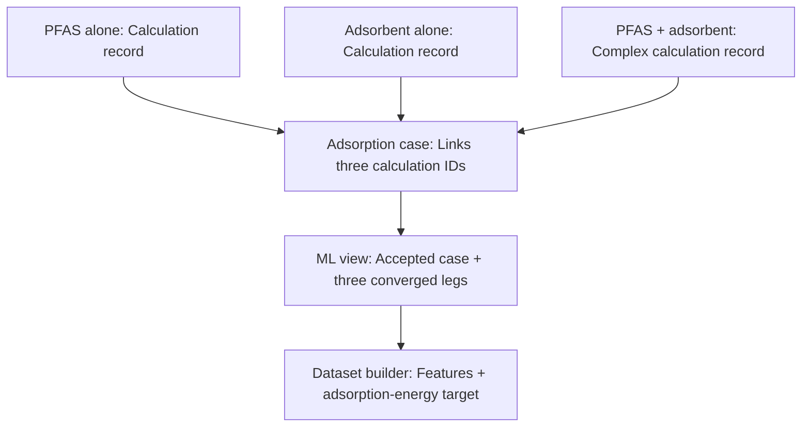
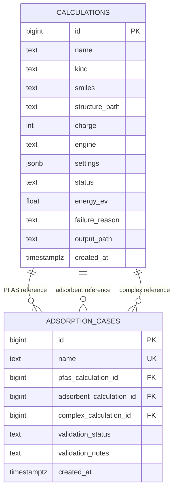

# PFAS Adsorption Database

**Team proposal · PostgreSQL / Neon · two tables and one ML view**

This database stores individual simulation results and links them to form
adsorption-energy labels. It supports results from Quantum ESPRESSO (QE),
PySCF, or ORCA while retaining the method used for each calculation.

The accompanying `schema.sql` creates the database structure. It does not
run simulations, import results, or validate calculation physics.

## The idea

One adsorption case needs three energies:

**Adsorption energy = Complex energy − Adsorbent energy − PFAS energy**

The complex is the PFAS and adsorbent together. Each energy comes from a
separate calculation. Negative adsorption energy means the combined system
is lower in energy than the chosen separated references.



## Schema relationship



PK = primary key (unique row ID). FK = foreign key (link to another row).
UK = unique value. All three references point to the same `calculations`
table, but to three distinct rows. A reference calculation can be linked to
multiple cases when reuse is scientifically appropriate.

## 1. `calculations`: individual simulation results

**One row represents one calculation of a particular structure and method.**

| Field | Store | Why |
|---|---|---|
| `id` | Automatically assigned ID | Link to this exact calculation |
| `name` | Descriptive run name | Recognize the system and run |
| `kind` | `pfas`, `adsorbent`, or `complex` | Identify the calculation's role |
| `smiles` | Molecular SMILES, when applicable | Reconstruct connectivity or generate molecular features |
| `structure_path` | Durable path/URI to the structure file | Preserve 3D coordinates or a surface structure |
| `charge` | Actual total charge used in the calculation | Distinguish neutral and charged systems |
| `engine` | `QE`, `PySCF`, `ORCA`, etc. | Identify the program used |
| `settings` | JSON object with method and provenance | Check compatibility and reproduce the calculation |
| `status` | `pending`, `running`, `converged`, or `failed` | Distinguish attempted from usable calculations |
| `energy_ev` | Converged total energy in eV | Supply one component of the adsorption-energy subtraction |
| `failure_reason` | Explanation if a calculation fails | Keep failures visible |
| `output_path` | Durable path/URI to the raw output | Inspect the original evidence |
| `created_at` | Automatic timestamp | Track when the row was inserted |

`smiles`, `structure_path`, and `output_path` may be null while records are
being prepared. Before accepting a label, retain the actual structures and
raw outputs in a location accessible to the team. A path is a reference:
the database does not upload or preserve the file itself.

Use a new calculation row for an independent rerun with changed settings or
geometry. Do not overwrite a completed calculation already used by a case.
For an evolving run, update its existing row as status changes.

### What goes in `settings`?

This field avoids adding many engine-specific columns. Use consistent keys
within the team. Example shape for a molecular GTO calculation (values are
illustrative, not a recommended calculation protocol):

```json
{
  "engine_version": "record-exact-version",
  "functional": "PBE",
  "basis_set": "def2-SVP",
  "reference_state": "neutral",
  "spin_multiplicity": 1,
  "dispersion": "record-method-or-none",
  "original_energy": -100.0,
  "original_energy_unit": "Hartree",
  "energy_conversion_to_ev": "record-constant-used",
  "calculation_type": "geometry_optimization",
  "scf_converged": true,
  "geometry_converged": true,
  "pipeline_git_sha": "record-commit"
}
```

For QE, record cutoffs, pseudopotential identities, k-points, cell and
periodicity, isolation corrections, and other relevant parameters instead
of a Gaussian basis set. Also retain convergence thresholds, geometry
generation method/version, and initial/final structure references.

All `energy_ev` values must use eV. During import, convert source energies
from Ry or Hartree as needed and retain the original energy, unit, and
conversion constant in `settings`. A common unit does not make different
methods scientifically interchangeable.

### Status rules

| Status | `energy_ev` | Meaning |
|---|---|---|
| `pending` | NULL | Planned calculation |
| `running` | NULL | Not yet validated as converged |
| `converged` | Required, finite number | Meets the required calculation-specific convergence criteria |
| `failed` | NULL | Attempt failed; document the reason |

The database enforces energy presence/absence and rejects NaN/infinity.
It cannot inspect output files to prove convergence. The importer/reviewer
must check the evidence before setting `converged`. An SCF solve finishing
does not establish that a requested geometry optimization finished.

## 2. `adsorption_cases`: connect the three results

**One row represents one adsorption setup, including its pose and convention.**

| Field | Store |
|---|---|
| `id` | Automatically assigned case ID |
| `name` | Unique descriptive name, e.g. `benzene_tfa_neutral_pose01_pbe` |
| `pfas_calculation_id` | ID of the PFAS-only row |
| `adsorbent_calculation_id` | ID of the adsorbent-only row |
| `complex_calculation_id` | ID of the combined-system row |
| `validation_status` | `pending`, `accepted`, or `rejected` |
| `validation_notes` | Reviewer, rule version, checks, reasons and reference convention |
| `created_at` | Automatic insertion timestamp |

Insert the three calculation records before creating the case. They can
still be pending. Different poses or independent protocol variants get
separate cases; the current design identifies those variants through names
and linked calculation settings.

The SQL enforces existing, distinct IDs. It does not enforce their roles
at insertion time; the ML view checks the roles before returning a row.

### When is a case accepted?

Check that all three calculations:

1. Have verified converged results.
2. Describe the intended components and combined system.
3. Use consistent composition and charge accounting for the declared reference.
4. Use compatible methods, numerical settings and simulation-cell conventions.
5. Retain sufficient input/output evidence and provenance.

Record the decision in `validation_notes`. Three converged calculations do
not automatically form a valid adsorption label. A neutral surface and an
anion do not need the same literal charge/reference-state value; they need
consistent accounting across the defined calculation.

Record any underbinding finding or benchmark discrepancy in the notes.
Do not silently shift stored energies by a guessed correction. This design
preserves each method's result so the team can select compatible data.

## 3. `ml_adsorption_data`: the ML query

This view returns only accepted cases with three converged calculations in
the correct roles. It computes adsorption energy directly from their eV
energies, avoiding a second stored value that could become inconsistent.

```sql
SELECT
    case_id,
    pfas_smiles,
    adsorbent_smiles,
    adsorbent_structure_path,
    adsorption_energy_ev
FROM ml_adsorption_data;
```

The view also exposes calculation IDs, charges, engines, and settings for
auditing and dataset selection. **It is not a substitute for scientific
validation and does not automatically separate incompatible methods.**

The dataset builder should select one declared protocol/reference
convention, generate molecular/adsorbent features, and export a frozen
training dataset. Use the features as inputs and `adsorption_energy_ev` as
the target. Do not include component energies or convergence diagnostics
as screening features.

Record selected case IDs, feature/checkpoint versions, exclusions and split
assignments alongside the export. Keep repeated poses of the same chemical
pair in the same split. The live view can change; a frozen export makes
training reproducible.

## Set up in Neon

### Option A: SQL Editor

1. Open the intended Neon project, branch and database.
2. Open SQL Editor.
3. Paste the complete contents of `schema.sql` and execute it.
4. Check the new objects:

```sql
SELECT COUNT(*) FROM calculations;
SELECT COUNT(*) FROM adsorption_cases;
SELECT * FROM ml_adsorption_data LIMIT 10;
```

The counts will be zero and the view empty until data is imported and
accepted. That is expected.

### Option B: connection string and `psql`

If `psql` is installed, run the following in Bash from the folder containing
`schema.sql`. Enter your Neon connection string at the hidden prompt:

```bash
read -r -s -p "Neon connection string: " DATABASE_URL
echo
export DATABASE_URL
psql "$DATABASE_URL" -v ON_ERROR_STOP=1 -f schema.sql
unset DATABASE_URL
```

Use the complete connection string Neon supplies, including its connection
parameters. Do not put credentials in this README, the SQL file, or Git.
The connection string is not needed to review the design.

### Existing objects

This is a first-time setup script, not a migration. It runs inside one
transaction and deliberately does not drop or overwrite existing tables.
If you already ran an earlier schema with these names, stop and compare
definitions before applying a migration. Do not delete existing data to
make this script run.

## Team ingestion workflow

| Step | Action | Destination |
|---|---|---|
| 1 | Run a simulation and retain its files | Team-accessible file storage |
| 2 | Parse identity, charge, engine/settings and status | `calculations` |
| 3 | Verify convergence and convert usable energy to eV | `calculations` |
| 4 | Link the PFAS, adsorbent and complex rows | `adsorption_cases` |
| 5 | Review compatibility and record the verdict | `adsorption_cases` |
| 6 | Select accepted results and generate ML features | Dataset builder using `ml_adsorption_data` |

The importer and dataset builder are future implementation work. This
package defines storage and the query boundary only. No database connection
or repository modification is performed by distributing these files.
